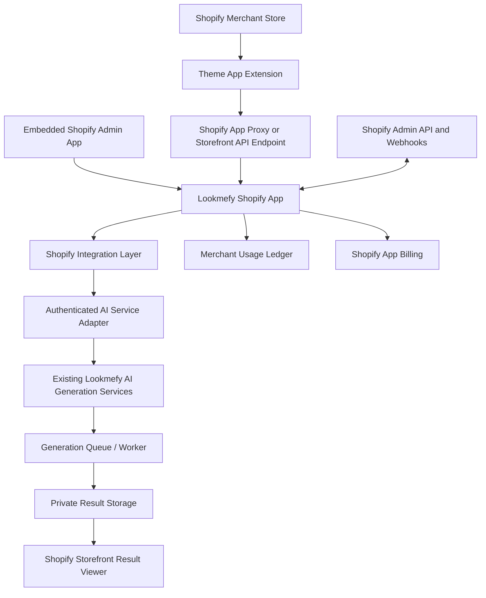
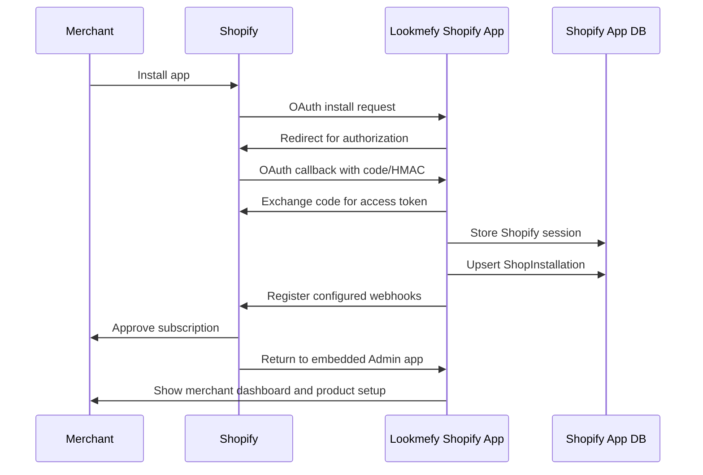
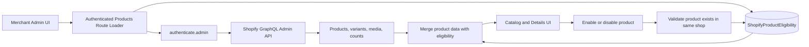
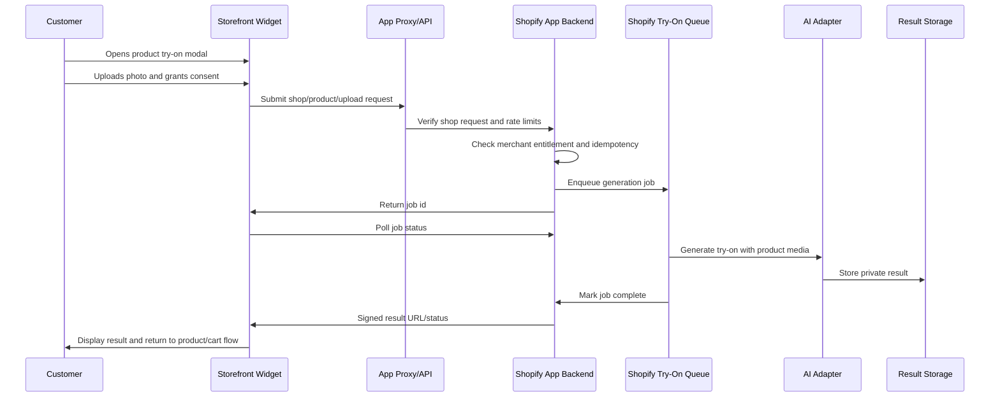
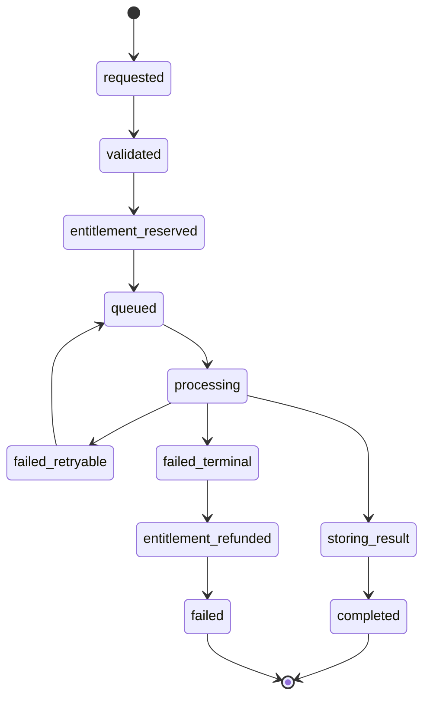
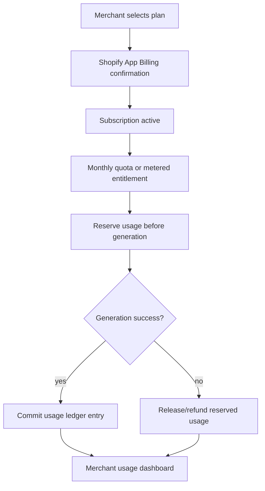
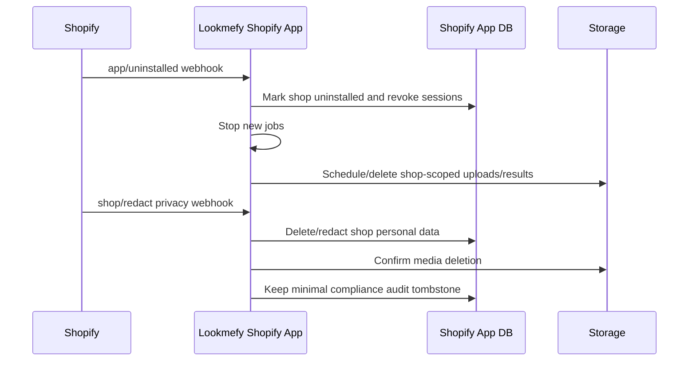

# Architecture

## Current Verified Architecture

The current Lookmefy backend is a consumer application. Try-on requests are authenticated with consumer `requireUser`, charged against `User.tokens`, generated by provider integrations in `server/routes/tryons.js`, optionally queued with BullMQ, and persisted to consumer `TryOn`, `CustomTryOn`, or `ExternalTryOn` models. Media is saved through `server/utils/storage.js`.

## Proposed Shopify Architecture

Shopify should be added as an isolated app in `shopify-app/` with its own merchant/session/product/job/billing models. It should call an internal Lookmefy AI service adapter rather than consumer endpoints.

## Merchant Installation Workflow

Phase 2 implements the embedded Admin app foundation, Shopify authentication boundary, Prisma-backed session storage, merchant installation state, and lifecycle/privacy webhook handlers. Phase 3 adds real Shopify product catalog reads and merchant-scoped product eligibility settings. Storefront try-on, AI generation, usage ledger, and billing remain future-phase design targets only.

Implemented Phase 2 files:

- `app/shopify.server.ts`: Shopify app configuration, React Router authentication exports, Prisma session storage.
- `app/routes/app.tsx`: embedded app provider and authenticated route boundary.
- `app/routes/app._index.tsx`: Lookmefy merchant dashboard shell and authenticated shop profile recording.
- `app/routes/webhooks.app.uninstalled.tsx`: uninstall webhook handler.
- `app/routes/webhooks.app.scopes_update.tsx`: scope update webhook handler.
- `app/routes/webhooks.privacy.tsx`: mandatory privacy webhook handler.
- `app/models/shop.server.ts`: merchant installation and webhook delivery persistence helpers.
- `prisma/schema.prisma`: Shopify session, installation, settings, and webhook delivery models.

Implemented Phase 3 files:

- `app/routes/app.products.tsx`: authenticated product catalog, search/filter/pagination, individual actions, and bulk eligibility actions.
- `app/routes/app.products.details.tsx`: authenticated product details view and eligibility action.
- `app/services/shopify-products.server.ts`: server-side Shopify Admin GraphQL reads for products, counts, media, variants, and product existence validation.
- `app/models/product-eligibility.server.ts`: merchant-scoped Prisma helpers for product eligibility.
- `prisma/migrations/202610130002_phase3_product_eligibility/migration.sql`: product eligibility table and shop/product uniqueness.
- `tests/phase3-products.test.mjs`: Phase 3 scope, route, GraphQL, and merchant isolation tests.

Phase 3 configuration boundaries:

- Only `read_products` is requested.
- No write scopes are requested.
- No customer data model is added.
- No AI provider keys or consumer-app auth paths are reused.
- No storefront app block, billing, deployment, production app URL, customer upload, or AI generation flow is configured.

## Product Synchronization Workflow

## Customer Virtual Try-On Workflow

## AI Generation Queue Lifecycle

## Merchant Billing and Quota Workflow

## Uninstall and Data Deletion Workflow

## Boundary Rules

- Shopify storefront code calls only Shopify-facing endpoints.
- Shopify backend owns Shopify OAuth, sessions, webhooks, billing, merchant settings, and product sync.
- AI adapter is server-only and authenticates to Lookmefy internals.
- Existing provider keys remain in server/worker environments.
- Existing consumer auth, credits, and payments are not reused for merchants.

