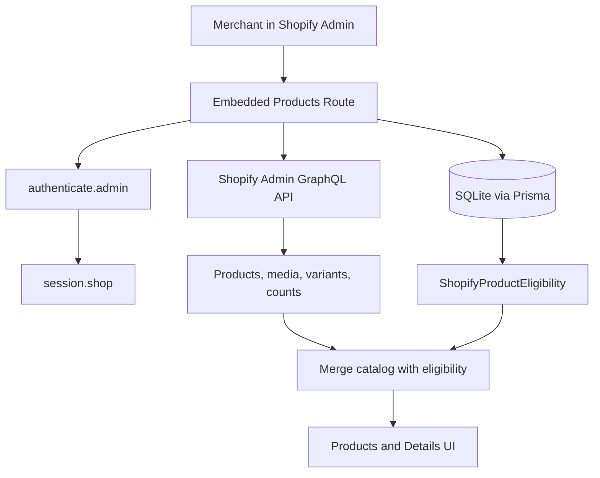
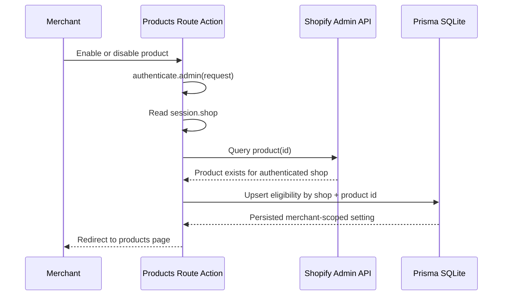

# Phase 3 Implementation Report

## Objective

Implement real Shopify product integration for the isolated Lookmefy Shopify embedded Admin app, using the minimum `read_products` scope and merchant-scoped eligibility persistence.

## Status

Source implementation: COMPLETE

Local validation: COMPLETE

Live development-store validation: PARTIAL

Production readiness: PENDING and separate from this phase

## Implemented Functionality

- Added `read_products` as the only Shopify Admin API scope.
- Added server-side product catalog loading through Shopify GraphQL Admin API.
- Added product search, status filtering, product type filtering, eligibility filtering, and cursor pagination.
- Added product thumbnails, fallback no-image state, status, product type, vendor, tags, variant previews, media previews, and price range display.
- Added product details route.
- Added individual product enable/disable controls for Lookmefy try-on eligibility.
- Added bulk enable/disable controls for selected visible products.
- Added `ShopifyProductEligibility` Prisma persistence with shop/product uniqueness.
- Validated product existence in Shopify before persisting eligibility changes.
- Derived merchant identity only from `authenticate.admin(request)` and `session.shop`.

## Scope Boundary

Allowed:

- `read_products`

Not requested or implemented:

- Product writes
- Customer reads/writes
- Order reads/writes
- Theme reads/writes
- Billing scopes
- AI provider API integration
- Customer upload handling
- Storefront/theme extension
- Production deployment

## Implementation Files

- `shopify.app.toml`
- `prisma/schema.prisma`
- `prisma/migrations/202610130002_phase3_product_eligibility/migration.sql`
- `app/models/product-eligibility.server.ts`
- `app/services/shopify-products.server.ts`
- `app/routes/app.products.tsx`
- `app/routes/app.products.details.tsx`
- `app/routes/app._index.tsx`
- `tests/phase2-foundation.test.mjs`
- `tests/phase3-products.test.mjs`

## Architecture

## Eligibility Write Flow

## Local Test Evidence

- `npm run setup`: PASS
  - Applied migration `202610130002_phase3_product_eligibility`.
- `npm test`: PASS
  - 16 passing tests.
- `npm run typecheck`: PASS
- `npm run lint`: PASS
- `npm run build`: PASS
- `npx prisma validate`: PASS

## Live Development-Store Evidence

- `npm run dev`: PASS
  - Org: `Lookmefy`
  - App: `Lookmefy AI Virtual Try-On`
  - Dev store: `lookmefy-try-on-dev.myshopify.com`
  - Shopify CLI reported `Access scopes auto-granted: read_products`.
- Embedded Admin root authentication: PASS
  - Development logs showed authenticated Admin requests for `lookmefy-try-on-dev.myshopify.com`.
- Real Admin GraphQL product query: PASS
  - `productsCount`: `17`
  - Count precision: `EXACT`
  - Sample returned products:
    - `Selling Plans Ski Wax`
    - `The Multi-managed Snowboard`
    - `The Collection Snowboard: Liquid`
    - `The Videographer Snowboard`
    - `The 3p Fulfilled Snowboard`
  - Verified real product fields: ID, title, status, product type, vendor, tags, featured media image, media previews, variant previews, and price range.
- Prisma eligibility persistence against real dev-store product ID: PASS
  - Product ID: `gid://shopify/Product/15600884023407`
  - Temporary enabled state persisted.
  - Temporary disabled state persisted.
  - Temporary validation record was cleaned up.
- Merchant visual confirmation for individual controls: PASS
  - Individual Enable changed counters from `0/17` to `1/16`.
  - Individual Disable changed counters back from `1/16` to `0/17`.
- Real product details and variants API validation: PASS
  - Product: `Selling Plans Ski Wax`
  - Variant count: `3`
  - Media count: `3`
  - First variant: `Selling Plans Ski Wax`, price `24.95`
- Real search/filter/pagination API validation: PASS
  - Search syntax defect found: `title:"Snowboard"` returned `0` products.
  - Fix implemented: search now uses Shopify-compatible title wildcard syntax.
  - Fixed query `title:*Snowboard*` returned `15` exact matching products.
  - Filter query `product_type:"snowboard" status:active` returned `12` exact matching products.
  - Pagination returned a second page and reported `hasPreviousPage: true`.
- Prisma persistence, bulk-style operations, and shop isolation: PASS
  - Two real product IDs were enabled in one transaction.
  - A new Prisma client observed both enabled records, validating persistence across a new DB client.
  - A separate shop record did not affect the authenticated shop count.
  - Both product IDs were disabled and validation records were cleaned up.
- Direct incorrect path check: FAIL as expected
  - Admin URL path `/products` returned `404 No route matches URL "/products"`.
  - The implemented embedded route is `/app/products`.

## Final Validation Fixes

- Fixed Shopify product title search from exact quoted title query to wildcard title query:
  - Before: `title:"Snowboard"`
  - After: `title:*Snowboard*`
- Fixed details route validation so malformed product IDs are rejected before Shopify Admin GraphQL is queried.
- Tightened enabled-filter behavior so local eligibility filtering respects search, status, and product type filters for enabled products loaded from Shopify.

## Security Notes

- Client requests do not provide or override the shop domain.
- Eligibility records are keyed by authenticated `session.shop`.
- The app validates Shopify product ownership before writes.
- No Shopify product write mutations are present.
- No existing Lookmefy production files were modified.
- No AI provider, billing, customer upload, storefront extension, deployment, publishing, commit, or production release action was performed.

## Pending Live Validation

The Shopify CLI auto-granted `read_products`, real dev-store products were verified through Admin GraphQL, and the merchant visually confirmed individual Enable/Disable with counters. Browser-level validation remains partial because no browser inspection tool was available and only the individual action flow was manually confirmed.

Pending checks:

- Browser refresh persistence after enabling one product.
- UI-driven bulk enable/disable for selected visible products.
- UI-driven product details page with variant information.
- UI-driven search, filters, and pagination.
- Dashboard link to product setup is visually confirmed after the final fixes.

## Live Webhook Behavior

Live product webhook behavior is unverified and not implemented in Phase 3. Existing Phase 2 lifecycle/privacy webhook handlers remain in place.

## Conclusion

Phase 3 source implementation, local validation, Shopify CLI startup, real dev-store product API validation, merchant-confirmed individual enable/disable, and Prisma persistence checks are complete. Phase 3 remains PARTIAL until the remaining embedded UI tests are manually confirmed.
